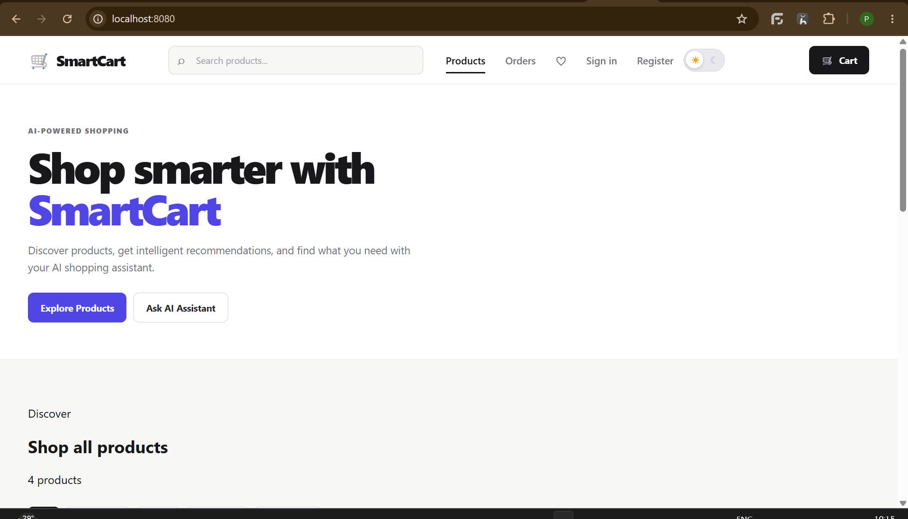

# SmartCart

## AI-Powered E-Commerce Platform

SmartCart is a modern AI-powered e-commerce platform designed as a production-style DevOps portfolio project.

The project combines a functional application with modern DevOps, cloud, security, observability, Kubernetes, and GitOps practices.

## Project Goals

- Build a functional e-commerce application.
- Add an AI-powered shopping assistant.
- Containerize the application with Docker.
- Deploy the application to Kubernetes using KIND.
- Package Kubernetes resources with Helm.
- Implement CI/CD with GitHub Actions.
- Add DevSecOps security scanning.
- Implement observability using OpenTelemetry, Prometheus, Grafana, and Tempo.
- Implement GitOps using Argo CD.
- Extend the platform to AWS using Terraform and Ansible.

## Application Stack

- React + TypeScript
- Python + FastAPI
- PostgreSQL
- Redis
- Ollama

## DevOps Stack

- Docker
- Docker Compose
- Kubernetes
- KIND
- Helm
- GitHub Actions
- Argo CD
- Terraform
- Ansible

## Security

- Semgrep
- Gitleaks
- Dependency vulnerability scanning
- Trivy
- SBOM generation
- Container image signing

## Observability

- OpenTelemetry
- Prometheus
- Grafana
- Tempo

## Architecture

```text
                       User
                         |
                         v
                React + TypeScript
                         |
                         v
                      FastAPI
                    /    |     \
                   v     v      v
             PostgreSQL Redis  Ollama
```

## Project Screenshots

### 1. SmartCart Application

Screenshot of the running e-commerce application.



### 2. Argo CD GitOps

Argo CD application view showing the synchronization status, health status, and deployed Kubernetes resources.


### 3. Grafana Monitoring

Grafana dashboard showing SmartCart application metrics and infrastructure monitoring.


### 4. GitHub Actions CI/CD

GitHub Actions workflow showing the CI/CD pipeline and its execution results.


## Project Status

SmartCart is being developed as a local-first DevOps portfolio project, with a planned AWS extension.

The project demonstrates application development, containerization, Kubernetes deployment, GitOps, automated delivery, security scanning, and observability.

## Future Enhancements

- Extend the deployment to AWS using Terraform and Ansible.
- Continue improving deployment automation, security, and operational documentation.
