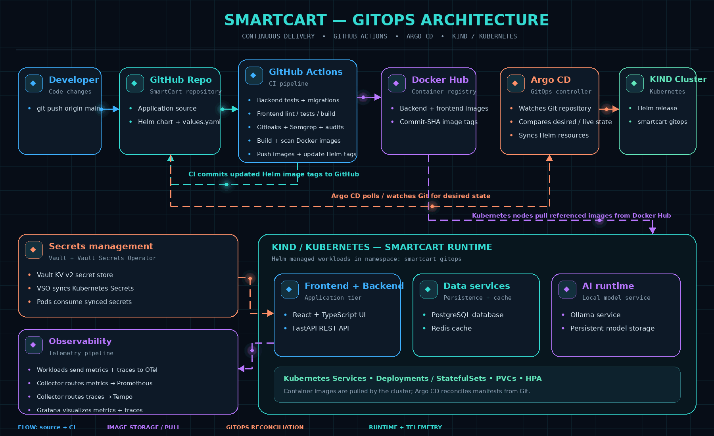
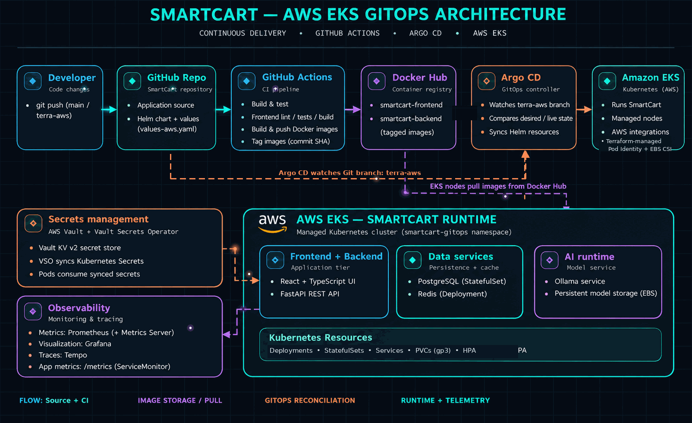
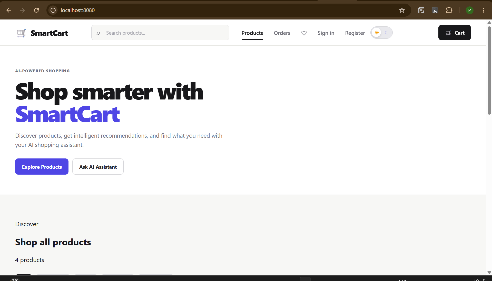
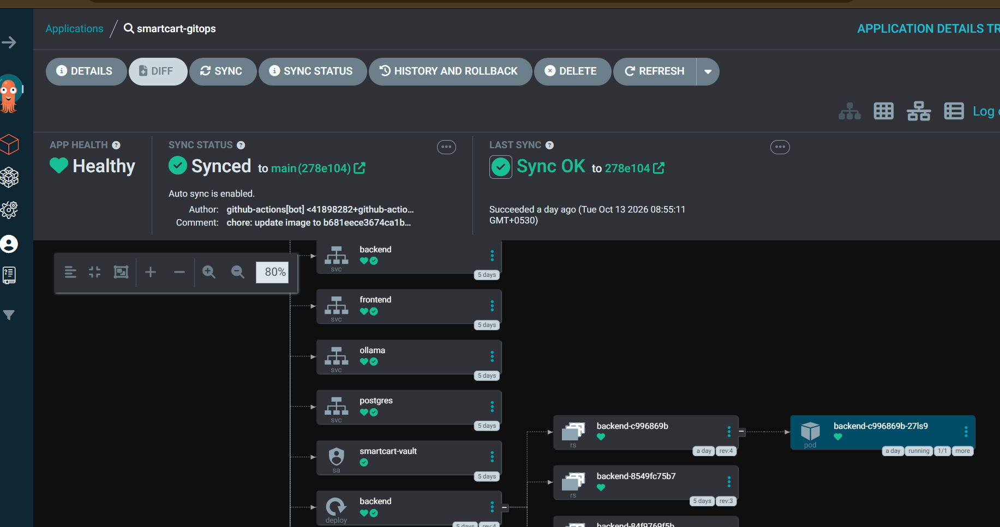
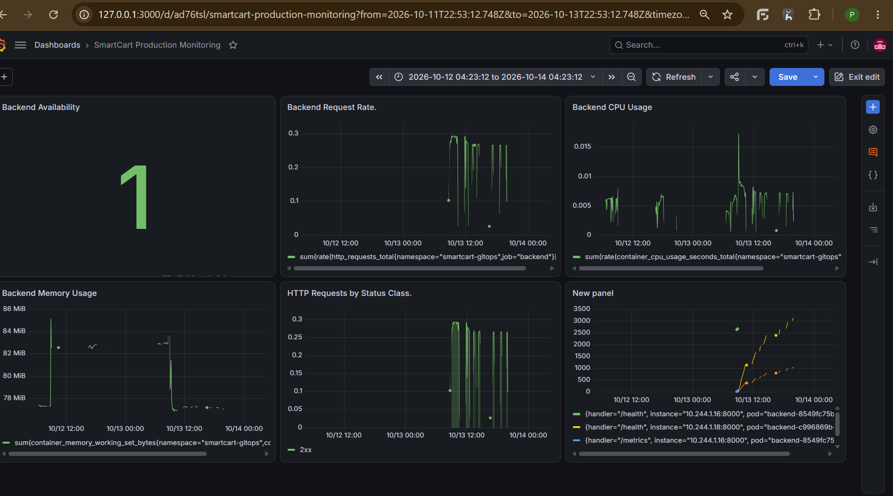
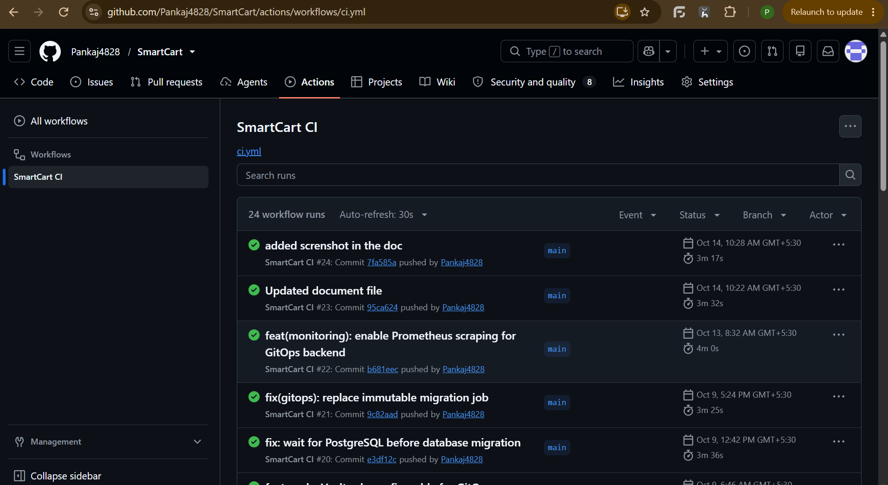

# SmartCart

## AI-Powered E-Commerce Platform

SmartCart is an AI-powered e-commerce application built as a hands-on DevOps portfolio project. It combines a React and FastAPI application with containerization, Kubernetes, CI/CD, GitOps, security scanning, secrets management and observability.

The project follows a local-first approach: the application is developed and operated locally with Docker and KIND, then extended to AWS using Terraform and Amazon EKS. The AWS environment was deployed and verified during Phase 3, then intentionally destroyed after testing to avoid ongoing cloud costs. The Terraform bootstrap configuration and remote-state S3 bucket were retained.

---

## Application Stack

| Layer | Technology | Responsibility |
|---|---|---|
| Frontend | React + TypeScript | E-commerce user interface |
| Backend | Python + FastAPI | REST APIs and application logic |
| Database | PostgreSQL | Persistent relational data |
| Cache | Redis | In-memory application support |
| AI runtime | Ollama | Local model runtime for the AI assistant |

## DevOps and Platform Stack

- **Containers:** Docker, Docker Compose
- **Orchestration:** Kubernetes, KIND, Amazon EKS
- **Packaging:** Helm
- **CI/CD:** GitHub Actions
- **GitOps:** Argo CD
- **Infrastructure as Code:** Terraform
- **Cloud platform:** AWS, Amazon EKS, EC2, EBS CSI and EKS Pod Identity
- **Secrets management:** HashiCorp Vault, Vault Secrets Operator
- **Observability:** OpenTelemetry, Prometheus, Grafana, Tempo

## Security

The CI workflow includes the following security and quality checks:

| Tool / Check | Purpose |
|---|---|
| Gitleaks | Scans checked-out repository files for exposed secrets |
| Semgrep | Static analysis of backend and frontend application source |
| Dependency audits | Checks backend and frontend dependencies |
| Trivy | Scans built backend and frontend container images for HIGH and CRITICAL vulnerabilities |

---

## Architecture

SmartCart was deployed and verified in two Kubernetes environments: a local KIND cluster and an AWS EKS environment.

### Local Kubernetes architecture — KIND



KIND (Kubernetes IN Docker) provides a local Kubernetes cluster for development and deployment testing. The project cluster configuration uses one control-plane node and two worker nodes.

Developers push source code and Helm configuration to GitHub. GitHub Actions validates the backend and frontend, runs security checks, builds and scans container images, publishes the images and updates the Helm image tags. Argo CD monitors the Git repository and reconciles the desired Helm release into the local KIND cluster.

The cluster runs the SmartCart frontend, FastAPI backend and supporting services, including PostgreSQL, Redis and Ollama. Vault and Vault Secrets Operator provide the configured secrets integration. Prometheus, Grafana, Tempo and OpenTelemetry provide metrics and distributed tracing.

### AWS Kubernetes architecture — Amazon EKS



The AWS deployment extended the platform to Amazon EKS with EC2 managed worker nodes. Terraform provisioned the EKS infrastructure and supporting IAM configuration. EKS Pod Identity provided workload identity, while the EBS CSI driver enabled persistent block storage.

Argo CD deployed the AWS-specific SmartCart Helm configuration and platform applications. Vault and Vault Secrets Operator handled application secret delivery, while Prometheus, Grafana and Tempo provided monitoring and tracing.

**Architecture diagram note:** The AWS illustration shows Amazon ECR in its image-delivery flow. In the completed Phase 3 deployment, SmartCart container images were pulled from Docker Hub; ECR was not among the deployed Terraform resources. The AWS environment was subsequently destroyed after deployment verification.

### Application component flow

```text
                 User
                   |
                   v
          React + TypeScript
                   |
                   v
                FastAPI
             /     |      \
            v      v       v
       PostgreSQL  Redis  Ollama
```

---

## Running SmartCart Locally

### Prerequisites

- Git
- Docker Engine and Docker Compose plugin
- KIND
- kubectl
- Helm

Verify the required tools:

```bash
docker --version
docker compose version
kind version
kubectl version --client
helm version
```

Clone the repository:

```bash
git clone https://github.com/Pankaj4828/SmartCart.git
cd SmartCart
```

### Run with Docker Compose

From the repository root:

```bash
docker compose up --build -d
docker compose ps
```

View application logs:

```bash
docker compose logs -f
```

Stop the Compose stack:

```bash
docker compose down
```

### Create the local KIND cluster

The project KIND configuration defines one control-plane node and two worker nodes.

```bash
kind create cluster --config kubernetes/kind/cluster.yaml
kubectl cluster-info --context kind-smartcart
kubectl get nodes
```

### Deploy with Argo CD

Install and configure Argo CD by following the repository setup guide:

[Argo CD and Helm setup guide](docs/ARGOCD_SETUP.md)

Register the SmartCart GitOps Application:

```bash
kubectl apply -f argocd/smartcart-application.yaml
kubectl get applications -n argocd
kubectl get pods -n smartcart-gitops
```

Argo CD reads the SmartCart chart from `helm/smartcart` and manages the application release in the `smartcart-gitops` namespace.

### Validate the Helm chart

Lint and render the chart:

```bash
helm lint helm/smartcart
helm template smartcart helm/smartcart \
  --namespace smartcart-helm \
  --set vault.role=smartcart-helm
```

The chart's Vault resources require the corresponding Vault and Vault Secrets Operator CRDs and configuration. Avoid managing the same release simultaneously through the Helm CLI and Argo CD.

For additional setup details, refer to the [Kubernetes guide](docs/kubernetes.md), [Helm guide](docs/helm.md) and [Argo CD setup guide](docs/ARGOCD_SETUP.md).

---

## CI/CD Pipeline

The workflow is defined in `.github/workflows/ci.yml`. The configured workflow runs on pushes to the `main` branch.

1. **Backend validation:** installs dependencies, runs backend tests and database/migration checks, and performs dependency auditing.
2. **Frontend validation:** installs dependencies, runs frontend tests, lints the source and builds the frontend.
3. **Secret scanning:** runs Gitleaks against checked-out repository files.
4. **Static analysis:** runs Semgrep against backend and frontend application source.
5. **Container build:** builds backend and frontend images with Docker Buildx.
6. **Image security:** scans both images with Trivy for HIGH and CRITICAL vulnerabilities.
7. **Image publishing:** publishes images with commit-SHA tags after the required validation and security jobs succeed.
8. **GitOps configuration update:** updates image tags in `helm/smartcart/values.yaml` and commits the updated values for Argo CD reconciliation.

The AWS OIDC validation job was separately gated by a GitHub repository variable. The manual AWS Phase 3 deployment and verification were completed; the environment was then intentionally torn down.

---

## Kubernetes, GitOps and Observability

### KIND and Helm

KIND provides the local Kubernetes environment. Helm packages SmartCart resources into the reusable chart under `helm/smartcart/`. The project uses separate namespaces for its deployment workflows to avoid overlapping resource ownership.

### Argo CD

Argo CD compares the desired state in Git with the live Kubernetes resources. When CI updates the image tags in the Helm values file, Argo CD detects the repository change and reconciles the application.

### Observability

- **Prometheus** collects metrics, including the backend metrics endpoint at `/metrics`.
- **Grafana** provides dashboards and data-source access.
- **OpenTelemetry** instruments application telemetry.
- **Tempo** stores and serves distributed traces.

The backend's configured trace export path sends OTLP gRPC traces to Tempo. Refer to the [observability setup guide](docs/argocd-observability-setup.md) for configuration and verification details.

### Secrets management

HashiCorp Vault stores application secrets. Vault Secrets Operator uses the configured Vault connection and Kubernetes authentication resources to synchronize the required values into Kubernetes Secrets consumed by SmartCart workloads.

---

## Challenges and Engineering Decisions

### Database startup and migration ordering

The migration Job could start before PostgreSQL was ready to accept connections. The chart was updated with a PostgreSQL readiness check and an init-container wait using `pg_isready` before the migration command runs.

Kubernetes resource creation order does not guarantee that a database process is ready to accept connections. The workload therefore needs an explicit service-readiness check.

### Immutable Kubernetes Job updates

Kubernetes Jobs have immutable fields. Updating a Job's pod template in place can fail during GitOps reconciliation. The migration Job configuration was adjusted to use replacement behavior rather than relying on an in-place pod-template update.

This accounts for Kubernetes resource immutability during GitOps reconciliation.

### PostgreSQL persistent-volume mount

During the AWS EKS deployment, the PostgreSQL volume mount required a dedicated `subPath: postgres`. The StatefulSet template was updated, and the PostgreSQL pod was recreated and verified as Running.

### Worker-node pod capacity

During AWS monitoring deployment, one Node Exporter pod remained Pending because of pod-capacity pressure on the four `t3.small` worker nodes. The other three Node Exporter pods were healthy. This was recorded as an observed capacity constraint during the deployment.

---

## Results and Verification

The following outcomes were verified during project testing:

- Product API listing, creation, search and pagination were exercised.
- The backend health endpoint returned a healthy response during local API testing.
- The Helm chart passed lint validation.
- Kubernetes HPA scaling from one to three replicas and back to one was tested.
- The SmartCart AWS Argo CD Application reached Synced / Healthy.
- The AWS database migration Job completed and PostgreSQL reached Running.
- The SmartCart frontend was accessed successfully through Kubernetes port-forwarding.
- The AWS Phase 3 Terraform destroy completed with 18 resources destroyed, and the development Terraform state was empty afterward.
- AWS verification showed no remaining EKS cluster, associated worker instances, available EBS volumes, load balancers or NAT gateways for the deployed environment.
- The Terraform bootstrap configuration and remote-state S3 bucket were retained.

No pipeline-duration or scale-up-time benchmark was recorded, so no timing metrics are stated.

---

## Project Screenshots

### 1. SmartCart Application

Screenshot of the running e-commerce application.



### 2. Argo CD GitOps

Argo CD application view showing the synchronization status, health status, and deployed Kubernetes resources.



### 3. Grafana Monitoring

Grafana dashboard showing SmartCart application metrics and infrastructure monitoring.



### 4. GitHub Actions CI/CD

GitHub Actions workflow showing the CI/CD pipeline and its execution results.



---

## Project Documentation

### Local platform

- [Architecture overview](docs/ARCHITECTURE.md)
- [Kubernetes guide](docs/kubernetes.md)
- [Helm guide](docs/helm.md)
- [Argo CD and Helm setup](docs/ARGOCD_SETUP.md)
- [Argo CD and observability setup](docs/argocd-observability-setup.md)

### AWS deployment

- [AWS documentation index](docs/aws/README.md)
- [Phase 3 deployment, verification and teardown runbook](docs/aws/phase3-deployment-verification-teardown.md)
- [Phase 3 final closeout](docs/aws/phase3-final-closeout.md)

---

## Project Summary

SmartCart demonstrates an end-to-end application delivery and DevOps workflow, covering application development, Docker, Kubernetes, Helm, GitHub Actions CI/CD, Argo CD GitOps, security scanning, secrets management, observability and Terraform-managed AWS infrastructure.

The local KIND environment and the AWS EKS deployment were both implemented and tested. The AWS Phase 3 environment was intentionally destroyed after verification to avoid ongoing cloud costs. The retained Terraform bootstrap and remote-state configuration preserve the infrastructure state-management foundation.
